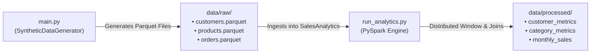

# E-Commerce Data Pipeline (PySpark & Synthetic Data)

An end-to-end data engineering and analytics pipeline built in Python and Apache Spark (PySpark). This project generates realistic synthetic e-commerce transactions (customers, product catalog, and orders) and processes them with PySpark to generate executive KPIs, product performance reports, and customer lifetime value insights.

---

## Architecture & Data Flow



---

## Project Folder Structure

```
Genai-pyspark-pipeline1/
│
├── data/
│   ├── raw/                           # Raw synthetic Parquet / CSV files
│   │   ├── customers.parquet
│   │   ├── products.parquet
│   │   └── orders.parquet
│   │
│   └── processed/                     # PySpark analysis output tables
│       ├── customer_metrics/
│       ├── category_metrics/
│       └── monthly_sales/
│
├── notebooks/                         # Interactive Jupyter notebooks
│   └── exploratory_analysis.ipynb
│
├── src/                               # Core Python source code
│   ├── __init__.py                    # Source package marker
│   ├── _init_.py                      # Empty package marker
│   ├── config.py                      # Centralized path, Spark, and logging settings
│   ├── data_generator.py              # SyntheticDataGenerator class (Faker + NumPy)
│   └── spark_analytics.py             # SalesAnalytics class (PySpark Engine)
│
├── tests/                             # Automated test suite
│   ├── __init__.py
│   └── test_pipeline.py               # Unit tests (unittest & pytest compatible)
│
├── main.py                            # Data generator entry point (exports Parquet)
├── run_analytics.py                   # PySpark analytics runner (benchmarks & displays KPIs)
├── .gitignore                         # Git exclusion rules
├── README.md                          # Project documentation
└── requirements.txt                   # Python dependencies
```

---

## Prerequisites

1. **Python 3.10+**
2. **Java JDK 11 or 17** (required for PySpark):
   ```powershell
   winget install EclipseAdoptium.Temurin.17.JDK
   ```
   Verify Java is accessible:
   ```powershell
   java -version
   ```

---

## Setup & Installation

1. **Activate your virtual environment**:
   ```powershell
   # Windows PowerShell
   .\.venv\Scripts\Activate.ps1
   ```

2. **Install project dependencies**:
   ```powershell
   pip install -r requirements.txt
   ```

---

## Running the Complete Pipeline

### Step 1: Generate Synthetic Parquet Datasets (`main.py`)

Run the data generator to create customer profiles, product catalog items, and orders modeled with a Pareto 80/20 distribution:

```powershell
# Fast preview run (1,000 customers, 100 products, 5,000 orders)
python main.py --fast

# Full scale run (100,000 customers, 10,000 products, 1,000,000 orders)
python main.py
```

*Outputs produced in `data/raw/`:*
- `customers.parquet`: Formatted IDs, names, emails, age (Normal distribution around 35), city, country, registration date.
- `products.parquet`: Product IDs, descriptive names, 5 categories, prices ($10–$500), stock levels, ratings (1–5).
- `orders.parquet`: Order IDs, customer IDs (Pareto distribution where top 20% place ~80% of orders), product IDs, quantities (1–10), order dates.

---

### Step 2: Run PySpark Analytics Job (`run_analytics.py`)

Execute distributed sales analytics with 4GB memory, Adaptive Query Execution (AQE), and Kryo serialization:

```powershell
python run_analytics.py
```

### Business Insights Displayed & Timed:
1. **Top 10 Customers by Revenue**: Ranks top spending customers (Pareto spenders) with total spend, order count, and average order value.
2. **Sales by Product Category**: Computes total revenue, units sold, and average price across `Electronics`, `Clothing`, `Home`, `Sports`, and `Books`.
3. **Monthly Trends & MoM Growth**: Applies Window `LAG` functions to calculate Month-over-Month revenue percentage growth chronologically.
4. **Operations Benchmark Report**: Details duration in seconds for each phase and overall job runtime.

---

## Running Automated Tests

Run the unit test suite:

```powershell
# Using Python's built-in test runner
python -m unittest discover tests

# Or using pytest
pytest tests/
```
